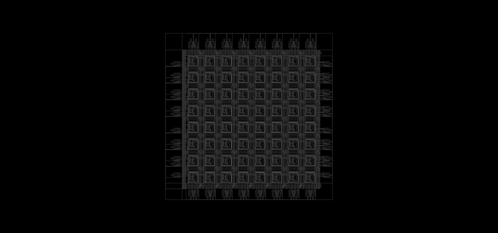

# prjfreeman: the Xilinx XC2064 in yosys and nextpnr



The XC2064 (1985) was the first FPGA: 64 Configurable Logic Blocks (CLBs) in an 8×8 grid and 58 I/O pins.
This repo models it as a nextpnr Himbächel uarch with a yosys plugin, so that Verilog designs can be
synthesized, placed and routed for the original chip and turned into a bitstream in the format of Xilinx's
XACT, all with an open-source flow.

> [!WARNING]
> **Not tested on real hardware.** None of the generated bitstreams has been loaded onto a real XC2064 yet.
> For 44 test runs, MAKEBITS from Xilinx's XACT produces bit-identical bitstreams from the same placement and
> routing, but the clock buffer codes come from XACT's model, and the edge of the IOB flip-flop and Shirriff's
> K mux codes have not been checked on a chip. See [Open items](docs/development-stages.md#open-items).

## What it can do

- **Synthesis:** the yosys plugin `synth_xc2064` maps Verilog onto the function generators of the CLBs (3- and
  4-input LUTs, the FGM mux mode), flip-flops and latches with asynchronous set/reset, latched inputs in the
  IOB and tristate or bidirectional pads.
- **Place & route:** a routing graph built from the real configuration bits (switch matrices, PIPs,
  single-length segments, Long Lines, the clock buffers GCLK and ACLK, repowering buffers), an exact legality
  check of every CLB, and timing for the speed grades -50 to -130 from the Xilinx Data Books.
- **Packages:** PC68, PD48, PC44 and PG68, pins constrained with a PCF file.
- **GUI:** a schematic of the whole chip with all lines, Bels and pips, in which every routed path can be
  followed from the pad to the flip-flop.
- **Bitstream:** `xc2064pack` writes RBT and BIT files in XACT's format; `xc2064unpack` and `xc2064netlist`
  turn a bitstream back into readable text and into a netlist.
- **Verification:** a regression test proves every result formally equivalent to the RTL (after routing, from
  the used pips alone and from the bitstream) and cross-checks the bitstreams with Ken Shirriff's independent
  decoder and with XACT.

## Quick start

This repo lives as `arch/xc2064` in the repo that builds yosys and nextpnr (`scripts/build-nextpnr.sh`); the
commands run from that repo's root:

```bash
git clone --recurse-submodules https://github.com/swittlich/prjfreeman arch/xc2064
scripts/build-nextpnr.sh debug     # nextpnr with the xc2064 uarch
arch/xc2064/flow.sh --gui          # synthesize examples/blinky.v, then Pack, Place, Route in the GUI
arch/xc2064/test/run.sh            # regression test over all examples
```

## Documentation

| Document | Contents |
|---|---|
| [Getting started](docs/getting-started.md) | Setup, running the flow, packages and speed grades, VS Code |
| [Examples](docs/examples.md) | The example designs and their results |
| [Architecture model](docs/architecture.md) | What is modelled and how: routing, CLBs, IOBs, clocks, packages, timing |
| [Synthesis](docs/yosys.md) | The yosys plugin `synth_xc2064` and its passes |
| [nextpnr uarch](docs/nextpnr.md) | Legality checks, packing, primitives, pin constraints, routing |
| [GUI](docs/gui.md) | How the chip is drawn |
| [Bitstream](docs/bitstream.md) | Generating bitstreams, the bitstream and text formats, the tools |
| [Testing](docs/testing.md) | Regression test, formal comparison, cross-check with Shirriff's decoder |
| [Data sources](docs/data-sources.md) | References, submodules, the `xc2064db` package, what the data tell us about the original |
| [Cross-checks with XACT](docs/xact.md) | Clock buffer codes from MAKEBITS, XNF netlists for XNFMAP |
| [Development stages](docs/development-stages.md) | Open items and how the model was built |

## Contributing

Contributions are welcome: bug reports, questions, improvements to the model, the tools or the documentation,
and above all anyone who can try a bitstream on a real XC2064. Please open an issue or a pull request on
[GitHub](https://github.com/swittlich/prjfreeman). Before submitting changes to the model or the tools, run
`arch/xc2064/test/run.sh` (every run must pass) and, for the bitstream tools, `arch/xc2064/test/bitstreams.sh`.
Contributions are accepted under the same license as the project (GPL-3.0-or-later, see [License](#license)).

## Acknowledgements

This work builds on Ken Shirriff's reverse engineering of the XC2064
([blog post](https://www.righto.com/2020/09/reverse-engineering-first-fpga-chip.html),
[shirriff/xc2064](https://github.com/shirriff/xc2064)), the XACT bitstreams in
[rates37/openxc2064](https://github.com/rates37/openxc2064) and the Xilinx Data Books. All references are
listed in [Data sources](docs/data-sources.md#references).

## License

Copyright (C) 2026 Sebastian Wittlich

This project is free software: you can redistribute it and/or modify it under the terms of the
[GNU General Public License](LICENSE) as published by the Free Software Foundation, either version 3 of the
License, or (at your option) any later version. In short: you may use, study, change and share it, but
whoever distributes it or a modified version must keep the copyright notices and make the complete source
code available under the same license.

The submodules in `external/` keep their own licenses. As usual with the GPL, your own designs and the
netlists and bitstreams the tools generate from them are not affected.
