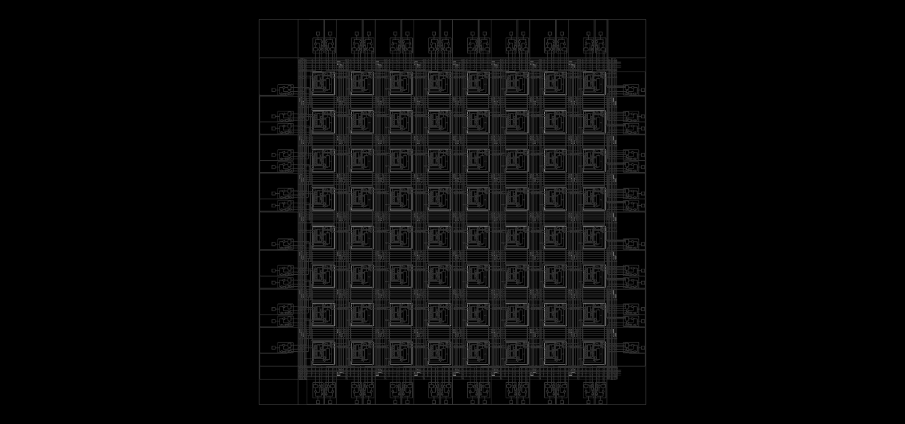
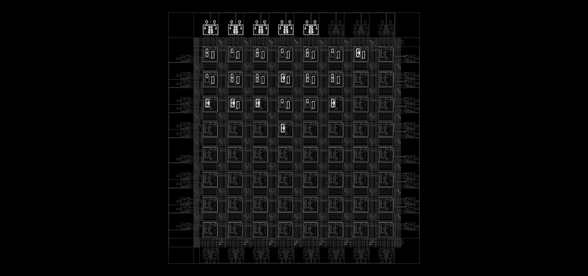
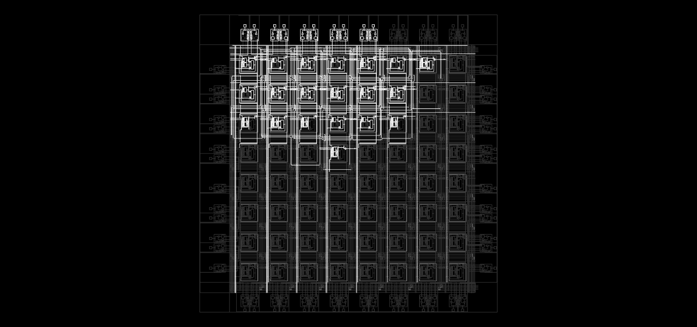

# GUI

The graphics are a schematic of the whole chip with **all lines, Bels and pips**. nextpnr otherwise hides
unused pips; `xc2064.cc` draws them dimmed. After routing, the used ones are highlighted, so that every path
can be followed from the pad through channels, switch matrices and input multiplexers into the LUTs and the
flip-flop. Hovering the mouse over a pip makes the GUI show its name.

| Empty chip | Packed (`blinky.v`) | Routed |
|---|---|---|
|  |  |  |

## Routing channels

The orientation follows the datasheet and die photos: X0Y0 at the top left. In the tiles X1Y1…X9Y9 the
switch matrices 8.1 and 8.2 sit at the top left, to their right the channel above the CLB, below them the
channel to the left of the CLB. The lines in them show the graph from the data:

- **Position:** The lines lie in the order and with the spacing from Shirriff's `draw.js`, at the edge
  with the additional Long Lines.
- **Switch matrices:** A frame around the pins. Each connection of the pattern is a line from pin to pin;
  used ones light up.
- **Single-length segments** end at the frames of the matrices.
- **Fifth vertical line:** Its piece starts at the box of the connection point at the top of the channel,
  runs a short way on the track of local.6 and then bends onto the track of local.5. The piece of the row
  above continues alongside it into the channel.
- **Long Lines and GCLK** run over the full height or width. GCLK comes in at the top as `CLK.AA.O` from
  pad P9, ACLK horizontally at the bottom from pad P43. The clock buffer inputs from lines are boxes in
  the corners: in AA, where `row.A.local.3`/`row.A.long.3` cross the column `col.A.clk` and
  `col.A.local.3`/`col.A.long.3` cross `CLK.AA.O` (for this, `CLK.AA.O` extends down to local.3 in AA), in
  II at `row.I.clk` and at a piece of ACLK at the right end that reaches up to `row.I.long.1`.
- **Repowering buffers** are two triangles tip to tip on the single-length segments at the section
  boundaries (before the channels of rows and columns D and G). They belong to the segment and light up
  with it.
- **PIP boxes** sit at every crossing that has a PIP bit.

## IOBs

The IOBs are drawn as in the datasheet: the pad outside, inside the frame the output driver (triangle
towards the pad) with its multiplexer and the smaller multiplexer for the tristate, next to it the input
driver (triangle pointing inwards). Output, tristate and input run as three lines across the channel
parallel to the edge. As with Shirriff, output and input then bend into a stub parallel to the edge that
crosses the lines of the channel perpendicular to the edge; the depth of the stubs is chosen so that the
pins of an IOB do not cross. `xc2064.cc` reads which crossings get a box from the pips of the chipdb, so
drawing the IOBs needs no table of its own.
Direct connections: on the right edge, X and Y of the CLB to the left run through the edge channel into the
output multiplexer of the first IOB; for the second IOB of the tile below they bend downwards before the
edge channel. At the top and bottom, X runs vertically into the output multiplexer of the second IOB (which
is drawn mirrored for this). The input from the pad runs on its stub at the top to A (branch on the track
of col.x to B), at the bottom to D (branch to C), on the left to B of the edge CLB. At P9 and P43 the input
crosses the clock line (`CLK.AA.O` or `row.I.clk`); the box there is the input of the clock buffer; the
output multiplexer has GCLK or ACLK on the same line as a source. P11 reaches GCLK at `col.A.clk`, P46
reaches ACLK via its stub down to `row.I.clk`.

The input follows Figure 3 of the datasheet: behind the input driver it branches, on the left directly, on
the right via the FF (clock with triangle), both into the input multiplexer, whose output is the line across
the channel. If the IOB is occupied, the multiplexer shows the selected path (`XC2000_INFF`: via the FF). The
clock K comes from outside, next to the IOB, from the clock line of its side, which runs along the outermost
chip edge. Its K mux lies at a corner as a stub on Shirriff's tracks: top `col.I.local.0` to the left of
column I down across the lines of row A, right `row.A.local.5` below the channel of row A, bottom
`col.A.local.5` up across the lines of row I, left `row.I.local.0` below that channel. Each source gets a
box there.

## CLBs

A CLB (grey frame) follows the block diagram in the datasheet, from left to right:

| Column | Contents |
|---|---|
| Inputs | A, B, C, D as rows from the left. A comes from the channel above, D from the channel below, B and C from the channel to the left |
| Combinational logic | Rails Q, D, C, B, A, the multiplexers of the LUT inputs, LUT F, LUT G and FG as a frame around both with the F/G multiplexer (B selects); FGM is the same multiplexer without the frame |
| Distributor | F, FG, G with the multiplexers for set (top), data, clock and reset (bottom) |
| Storage element | D and clock (triangle) on the left, S at the top, R at the bottom, Q on the right |
| Outputs | Rails F, FG, G, Q with the multiplexers X and Y, both out to the right through the channel (PIP boxes on their tracks and Long Lines) |

As in the datasheet, A runs above the logic to the set multiplexer. C, the clock signal K (from long.2 or
GCLK) and D run below the logic to clock and reset. F, FG and G run above the storage element to the outputs,
Q runs around the bottom back to the LUTs. The direct lines of X run up and down the right edge to the pins
of the CLB above or below, Y continues through the channel into the B row of the CLB to the right. No line
runs through a component. In routing, every wire draws its whole line up to the crossings where it can be
switched, including the direct lines and the pad connections. The pip there is just the box, like metal and
switch in the chip. Selecting a wire therefore lights up the whole line. Inside the CLB, pips are a tap
with a dot on the rail. A used pip additionally shows its path through the multiplexer. In FG mode the
multiplexers of F and G, the frame and the F/G multiplexer light up. In the mux mode FGM, F, G and the F/G
multiplexer light up without the frame (two functions), and at F and G only the input multiplexers that its
table needs.

Because nextpnr itself draws with y pointing up, `xc2064.cc` mirrors the graphics. Because nextpnr passes
`drawPip` the canonical wire of a node (which may lie in a neighbouring tile), `local_gfx_id()` looks up the
wire in the pip's tile.

## Image without the GUI

A `--post-route` script with `ctx.writeSVG("chip.svg", "scale=300")` produces an image of the whole chip without the GUI.
The SVG draws in a fixed order, not by state. A dimmed line can therefore cover a used one at the same
position there (FG uses the multiplexers of F and G). The GUI always draws used items on top.
